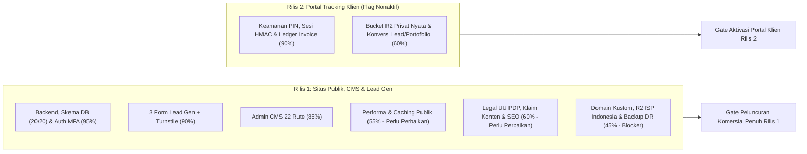

# Audit Mendalam Kesiapan Rilis — OpenByte Labs

> **Catatan 11 November 2026:** ini snapshot audit 6 November 2026, **bukan status terkini**.
> Setelah audit ini, migrasi 0020 terpasang (21 migrasi), backup harian dan restore drill
> berjalan, portal tracking aktif, dan seluruh gate R2-G1…G6 lulus. Rujukan status:
> `docs/RELEASE-1-2026-11-03.md` dan `docs/RELEASE-2-2026-11-07.md`. Salinan identik
> berkas ini dipindahkan secara reversibel ke `.local/audit_kesiapan_rilis.duplicate.md`.

**Tanggal Audit:** 6 November 2026  
**Acuan Spesifikasi:** [PRD_v1_6_2.md](file:///C:/FLUTTER%20PROJEK/gabut/OpenByteLabs/PRD_v1_6_2.md) & Log Produksi [RELEASE-1-2026-11-03.md](file:///C:/FLUTTER%20PROJEK/gabut/OpenByteLabs/docs/RELEASE-1-2026-11-03.md)  
**Cakupan:** Arsitektur Full-Stack Next.js 16, Database Neon PostgreSQL, Cloudflare R2 & Turnstile, Admin CMS, Portal Tracking Klien, Keamanan, Performa, SEO/A11y, Kepatuhan UU PDP, CI/CD & DR.

---

## 1. Ringkasan Eksekutif & Skor Kesiapan

Secara garis besar, codebase **OpenByte Labs** memiliki fondasi rekayasa *backend*, skema database, keamanan otorisasi, dan portabilitas yang **sangat solid** (seluruh 20 migrasi skema telah teraplikasi, 366 *unit test* lulus 100%, *zero vendor lock-in* ke runtime Vercel, dan validasi Zod/RBAC/MFA berjalan disiplin).

Namun, kesiapan rilis saat ini berada dalam **realitas dua jalur (*two-track reality*)**:

1. **Rilis 1 sebagai *Soft-Live MVP* (`openbyte-labs.vercel.app`) — ~84% Siap (Sudah Tayang):** Sejak 3–4 November 2026, situs utama, 22 rute Admin CMS, dan 3 alur penangkapan prospek (Kontak, Kalkulator, Booking Konsultasi) sudah aktif di produksi dan lolos 26/26 *smoke check* HTTP serta uji kiriman manusia nyata dengan Cloudflare Turnstile.
2. **Rilis 1 untuk *Peluncuran Komersial Penuh (Hard Release)* — BELUM SIAP (*Blocked*):** Masih terdapat **6 kelompok temuan P0/P1** yang melanggar kriteria penerimaan [PRD_v1_6_2.md](file:///C:/FLUTTER%20PROJEK/gabut/OpenByteLabs/PRD_v1_6_2.md) (§6–§9), mulai dari pemblokiran gambar R2 `r2.dev` di jaringan Telkomsel/IndiHome, regresi `SplashScreen` di *working tree* lokal yang merusak target `LCP <= 1.8s`, *dead cache invalidation* (`revalidateTag` tanpa `cacheTag`/`unstable_cache`), font ikon 4,0 MB, *checkbox* persetujuan privasi yang tercentang otomatis (melanggar UU PDP), hingga *backup* terenkripsi otomatis yang belum aktif.
3. **Rilis 2 (*Client Tracking Portal* & Penagihan) — ~78% Selesai di Kode (Masih Dimatikan di Produksi):** Logika inti keamanan PIN `scrypt`, sesi HMAC terpisah, *rate limiting* PostgreSQL, *state machine* revisi, serta *ledger* pembayaran & invoice sudah terbangun rapi, tetapi masih memerlukan verifikasi *bucket* privat R2 nyata dan penyelesaian 4 celah alur operasional sebelum `trackingEnabled` aman diaktifkan.

> [!CAUTION]
> **Jangan men-deploy perubahan *uncommitted* di *working tree* saat ini apa adanya.** Komponen baru [`SplashScreen`](file:///C:/FLUTTER%20PROJEK/gabut/OpenByteLabs/src/components/public/SplashScreen.tsx#L9-L88) yang dipasang di [`RootLayout`](file:///C:/FLUTTER%20PROJEK/gabut/OpenByteLabs/src/app/layout.tsx#L47) menahan seluruh halaman (termasuk `/admin` dan `/tracking`) selama **2,5–3,1 detik** pada setiap muat ulang, langsung menggagalkan target `LCP <= 1.8s` PRD §6.1 & §9.4.

### Peta Status Kesiapan Sistem

### Matriks Skor Kesiapan per Dimensi

| Dimensi Evaluasi | Skor | Status | Ringkasan Kondisi Aktual |
| :--- | :---: | :---: | :--- |
| **Arsitektur Backend, RBAC & Keamanan Auth** | **93%** | Siap | Better Auth + TOTP Owner + pemeriksaan `mfaVerified` sesi, CSRF origin check, RBAC terpusat di [rules.ts](file:///C:/FLUTTER%20PROJEK/gabut/OpenByteLabs/src/access/rules.ts), transaksi anti-*double-booking* PostgreSQL `EXCLUDE USING gist`. |
| **Alur Lead Generation (Kontak, Quote, Booking)** | **88%** | Siap dengan Catatan | Sudah teruji *end-to-end* di produksi (`INQ`, `QTE`, `BKG`). Catatan penting: *checkbox* privasi di [`Calculator`](file:///C:/FLUTTER%20PROJEK/gabut/OpenByteLabs/src/components/public/Calculator.tsx#L121) masih `true` secara bawaan. |
| **Admin CMS (22 Rute Operasional & Konten)** | **83%** | Fungsional | Seluruh rute di [page.tsx](file:///C:/FLUTTER%20PROJEK/gabut/OpenByteLabs/src/app/admin/[[...path]]/page.tsx) sudah aktif, namun [`AdminSettingsPage`](file:///C:/FLUTTER%20PROJEK/gabut/OpenByteLabs/src/components/admin/AdminSettingsPage.tsx#L83-L118) & sebagian [`AdminProjectsPage`](file:///C:/FLUTTER%20PROJEK/gabut/OpenByteLabs/src/components/admin/AdminProjectsPage.tsx#L926-L950) masih mengandalkan `<textarea>` JSON mentah. |
| **Portal Klien & Billing (Rilis 2)** | **78%** | Tertahan (*Gated*) | Kode inti lengkap di [tracking-store.ts](file:///C:/FLUTTER%20PROJEK/gabut/OpenByteLabs/src/db/tracking-store.ts); kurang uji transfer R2 privat nyata, konversi 1-klik lead->proyek, & alur izin portofolio. |
| **SEO, Aksesibilitas & Kejujuran Konten Publik** | **62%** | Perlu Perbaikan | Sitemap & OG dasar aktif, tetapi belum ada JSON-LD Schema.org, kontras `#82b440` gagal WCAG AA, `/paket` & `/kalkulator` mengikat slug statis, dan ada metrik fallback `99.9%` di [`ProjectDetail`](file:///C:/FLUTTER%20PROJEK/gabut/OpenByteLabs/src/components/public/ProjectDetail.tsx#L325-L333). |
| **Kepatuhan Hukum & UU PDP No. 27/2022** | **58%** | Belum Memenuhi PRD | Teks `privacyPolicy` produksi masih memakai fallback ringkas (belum memuat daftar sub-prosesor & klausul wajib Lampiran E.2 PRD), *consent* kalkulator tercentang otomatis, dan stub `retention:run` belum ada. |
| **Performa Web & Caching (`LCP <= 1.8s`)** | **52%** | Kritis | Font simbol **4,0 MB** (`font-display: block`), seluruh halaman publik `force-dynamic` tanpa cache baca DB (`revalidateTag` jadi *no-op*), `Image unoptimized`, ditambah regresi lokal `SplashScreen`. |
| **Infrastruktur Komersial, Jaringan ISP & DR Backup** | **48%** | **Blocker Utama** | Domain masih `*.vercel.app`, URL media `*.r2.dev` diblokir DNS Telkomsel/IndiHome, workflow [backup.yml](file:///C:/FLUTTER%20PROJEK/gabut/OpenByteLabs/.github/workflows/backup.yml) nonaktif, *restore drill* belum pernah dijalankan, rotasi *secret* tertunda. |

---

## 2. Hasil Verifikasi Teknis Aktual Codebase

Pengujian statis dan unit dijalankan langsung pada *workspace* saat audit berlangsung dengan hasil sebagai berikut:

| Pemeriksaan | Perintah | Hasil | Detail Temuan |
| :--- | :--- | :---: | :--- |
| **TypeScript Strict Check** | `pnpm typecheck` | **LULUS (0 Error)** | Kompilasi `tsc --noEmit` bersih di seluruh `src/`, `scripts/`, dan `tests/`. |
| **ESLint Quality Gate** | `pnpm lint` | **LULUS (0 Error, 9 Warning)** | 8 *unused-vars warning* minor pada komponen admin/skrip dan 1 `@next/next/no-img-element` pada file lokal baru [SplashScreen.tsx](file:///C:/FLUTTER%20PROJEK/gabut/OpenByteLabs/src/components/public/SplashScreen.tsx#L62). |
| **Portability & Anti-Lock-in** | `pnpm check:portability` | **LULUS** | Skrip [check-portability.mjs](file:///C:/FLUTTER%20PROJEK/gabut/OpenByteLabs/scripts/check-portability.mjs) memastikan nihil ketergantungan `@vercel/*`, `edge` runtime, dan `dangerouslySetInnerHTML` liar. |
| **Automated Unit & Schema Suite** | `pnpm test` | **LULUS (77/77 File, 366/366 Test)** | Mencakup RBAC, sanitasi HTML, kuota revisi, kalkulasi invoice, rate-limit, validasi env, dan transformasi DTO publik. |
| **Migrasi & Smoke Produksi** | Catatan Rilis 4–5 Nov | **20/20 Migrasi, 26/26 HTTP Check** | Branch `main` Neon (`openbyte_labs`) sinkron dengan Drizzle `0000`–`0019`; `/health` mengembalikan `200 {"ok":true}`. |

---

## 3. Temuan Kritis pada Working Tree Lokal Saat Ini

Terdapat 4 perubahan lokal yang belum di-*commit* (`git status`), dan **2 di antaranya menimbulkan regresi serius terhadap spesifikasi PRD**:

### 3.1 `SplashScreen.tsx` + `src/app/layout.tsx` (Blocker Performa & UX)
* **Lokasi:** [`SplashScreen`](file:///C:/FLUTTER%20PROJEK/gabut/OpenByteLabs/src/components/public/SplashScreen.tsx#L9-L88) dan pemasangan global di [`RootLayout`](file:///C:/FLUTTER%20PROJEK/gabut/OpenByteLabs/src/app/layout.tsx#L5) & [#L47](file:///C:/FLUTTER%20PROJEK/gabut/OpenByteLabs/src/app/layout.tsx#L47).
* **Masalah Teknis & Produk:**
  1. **Merusak LCP & Mengunci Scroll:** Timer `setTimeout(..., 2500)` dan penghapusan DOM di `3100ms` dengan `fixed inset-0 z-[99999]` serta `document.body.style.overflow = "hidden"` menahan interaksi di setiap *hard load* / *refresh* tanpa penjaga `sessionStorage`. Ini langsung melanggar syarat **PRD §6.1 & §9.4 (`LCP <= 1.8 detik` di jaringan 4G)**.
  2. **Bocor ke Rute Admin & Portal Klien:** Karena diletakkan di `src/app/layout.tsx` (bukan layout publik), operator yang membuka `/admin/*` maupun klien di `/tracking/*` juga dipaksa menunggu animasi splash 2,5 detik.
  3. **Aset Logo Tidak Optimal:** Memakai tag `` mentah ([SplashScreen.tsx](file:///C:/FLUTTER%20PROJEK/gabut/OpenByteLabs/src/components/public/SplashScreen.tsx#L62-L66)) ke `/images/OpenByte Labs Tech Logo-1.png` berukuran **442 KB** dengan spasi tanpa URL-encoding, padahal tersedia logo vektor resmi [openbyte-labs-official-brand-logo.svg](file:///C:/FLUTTER%20PROJEK/gabut/OpenByteLabs/public/brand/openbyte-labs-official-brand-logo.svg) yang hanya **4,4 KB** (100x lebih ringan).
  4. **Mengabaikan `prefers-reduced-motion`:** Meskipun CSS global memangkas durasi transisi bagi pengguna sensitif gerak, *timer* JavaScript `2500ms`/`3100ms` tetap menahan layar penuh selama 2,5 detik.
  5. **Melanggar PRD §9.1:** Kriteria penerimaan menetapkan tampilan publik mengikuti *prototype* referensi tanpa menyisipkan aturan visual baru di luar kontrak desain.
* **Rekomendasi:** Batalkan pemasangan [`SplashScreen`](file:///C:/FLUTTER%20PROJEK/gabut/OpenByteLabs/src/components/public/SplashScreen.tsx) di [`RootLayout`](file:///C:/FLUTTER%20PROJEK/gabut/OpenByteLabs/src/app/layout.tsx#L47) (cukup andalkan [`NavigationProgress`](file:///C:/FLUTTER%20PROJEK/gabut/OpenByteLabs/src/app/layout.tsx#L48) yang sudah ringan dan non-blocking).

### 3.2 Hardcode Logo pada `PublicFooter.tsx` (Memutus Kontrol Admin CMS)
* **Lokasi:** [`PublicFooter`](file:///C:/FLUTTER%20PROJEK/gabut/OpenByteLabs/src/components/public/PublicFooter.tsx#L68-L76).
* **Masalah:** Diff lokal mengganti ekspresi dinamis `settings?.general.logoUrl ?? "/images/5f9e6a2ac345b8dc.png"` menjadi string statis `"/images/5f9e6a2ac345b8dc.png"`. Akibatnya, perubahan logo melalui `/admin/pengaturan` hanya mengubah header ([`PublicHeader`](file:///C:/FLUTTER%20PROJEK/gabut/OpenByteLabs/src/components/public/PublicHeader.tsx#L58)), sedangkan footer tidak pernah ikut berubah (melanggar PRD §1.2 & §3.1).
* **Akar Masalah Sebenarnya:** Perubahan ini tampak sebagai *workaround* lokal akibat gagal muatnya URL R2 `*.r2.dev` di ISP Indonesia. Solusi benarnya adalah memperbaiki domain aset R2 (lihat §4.1) atau menambahkan `onError` fallback pada komponen gambar, bukan mematikan binding CMS.

---

## 4. Analisis Mendalam Kekurangan Rilis 1 (Menuju Peluncuran Komersial Penuh)

### 4.1 Infrastruktur, Domain Komersial & Pemblokiran R2 di ISP Indonesia (P0 — Blocker)
1. **Blokir DNS/TLS `*.r2.dev` oleh Telkomsel / IndiHome:**
   * Sebagaimana tercatat di [RELEASE-1-2026-11-03.md](file:///C:/FLUTTER%20PROJEK/gabut/OpenByteLabs/docs/RELEASE-1-2026-11-03.md) §3.4, `R2_PUBLIC_BASE_URL` saat ini masih menunjuk ke `https://pub-56e1d9e9745541f7bbe1141aa7cc3be3.r2.dev`.
   * Pada jaringan Telkomsel/IndiHome (pangsa pasar ISP terbesar di Indonesia), domain `r2.dev` dibelokkan oleh DNS positif ke `202.3.218.139` (`internetbaik.telkomsel.com`) sehingga browser menolak koneksi dengan `ERR_CERT_COMMON_NAME_INVALID`. **Seluruh gambar portofolio dan media yang diunggah ke R2 akan pecah (broken image) bagi mayoritas calon klien di Indonesia.**
   * Selain itu, Cloudflare sendiri menetapkan subdomain `*.r2.dev` hanya untuk pengembangan (*rate-limited*) dan menyarankan menonaktifkannya di produksi.
2. **Belum Memiliki Domain Kustom & Paket Hosting Komersial (PRD §7.6 & §7.7):**
   * Aplikasi masih berjalan di `https://openbyte-labs.vercel.app`. PRD §7.6 dan §7.7 mewajibkan domain bisnis resmi + paket hosting yang mengizinkan penggunaan komersial sebelum peluncuran bisnis penuh.
   * **Daftar Ketergantungan Saat Cutover Domain Baru:**
     * Pasang *Custom Domain* pada bucket publik R2 (mis. `assets.<domain-anda>`) lalu matikan akses `r2.dev`.
     * **Buat ulang widget Cloudflare Turnstile** (kunci Turnstile terikat ketat pada hostname; memakai kunci lama di domain baru akan menyebabkan seluruh form Kontak/Kalkulator/Booking gagal validasi).
     * Perbarui `SITE_URL`, `BETTER_AUTH_URL`, dan `R2_PUBLIC_BASE_URL` di environment produksi (divalidasi ketat oleh [`getEnv`](file:///C:/FLUTTER%20PROJEK/gabut/OpenByteLabs/src/env.ts#L64-L141) dan CSP di [next.config.ts](file:///C:/FLUTTER%20PROJEK/gabut/OpenByteLabs/next.config.ts)).
     * Submit ulang `sitemap.xml` domain baru di Google Search Console & pasang *redirect* `308` dari domain staging bila diperlukan.

### 4.2 Backup Otomatis, Disaster Recovery & Keamanan Operasional (P0/P1)
1. **Workflow Backup Terenkripsi Masih Nonaktif (Melanggar PRD §7.5 & §9.4):**
   * File [.github/workflows/backup.yml](file:///C:/FLUTTER%20PROJEK/gabut/OpenByteLabs/.github/workflows/backup.yml#L22-L60) memiliki *guard* `if: vars.BACKUP_ENABLED == 'true'`. Saat ini variabel tersebut belum diaktifkan dan 4 *secret* (`BACKUP_DATABASE_URL`, `BACKUP_ENCRYPTION_KEY`, `BACKUP_R2_ACCESS_KEY_ID`, `BACKUP_R2_SECRET_ACCESS_KEY`) belum diisi di GitHub Actions.
   * File lokal `backups/backup-prod-2026-11-04.json` hanyalah *snapshot* JSON manual tak terenkripsi yang mencakup **18 dari 45 tabel**, bukan hasil `pg_dump` penuh terenkripsi AES-256-GCM dari [backup.ts](file:///C:/FLUTTER%20PROJEK/gabut/OpenByteLabs/scripts/backup.ts).
2. **Restore Drill Belum Pernah Dijalankan:**
   * Skrip [restore-drill.ts](file:///C:/FLUTTER%20PROJEK/gabut/OpenByteLabs/scripts/restore-drill.ts) sudah tersedia di repo, tetapi **belum pernah dijalankan satu kali pun** terhadap branch Neon kosong untuk membuktikan RPO <= 24 jam, RTO <= 4 jam, dan keutuhan *constraint* GiST `consultation_bookings_no_overlap` (syarat wajib PRD §7.5 & §9.4).
3. **Rotasi Kredensial Produksi yang Tertunda:**
   * Sesuai catatan jujur di [RELEASE-1-2026-11-03.md](file:///C:/FLUTTER%20PROJEK/gabut/OpenByteLabs/docs/RELEASE-1-2026-11-03.md) §6, kredensial produksi sempat muncul pada transkrip sesi agen tanggal 3 November 2026 dan rotasinya ditunda oleh owner.
   * **Peringatan Teknis Saat Rotasi:** Merotasi password role Neon, R2 API Token, `IP_HASH_SALT`, dan `TURNSTILE_SECRET_KEY` dapat dilakukan langsung, **tetapi hati-hati saat merotasi `BETTER_AUTH_SECRET`** karena Better Auth menggunakan secret tersebut untuk mengenkripsi secret TOTP 2FA di tabel `two_factor` — merotasinya tanpa menyiapkan pencabutan/pendaftaran ulang TOTP owner akan mengunci login MFA owner!
4. **Risiko Salah Target pada Branch `dev` Neon:**
   * Branch `dev` di Neon masih menyimpan 5 database lama, termasuk satu bernama `openbyte_labs` (16 migrasi) yang **identik namanya** dengan database produksi di branch `main` (`openbyte_labs`, 20 migrasi), serta `openbyte_labs_r1_test` yang tertinggal 1 migrasi (19/20). Sebaiknya segera dirapikan agar operator tidak salah menempelkan *connection string*.
5. **Header IP Client & Observability Produksi:**
   * [`clientIpFromHeaders`](file:///C:/FLUTTER%20PROJEK/gabut/OpenByteLabs/src/security/client-ip.ts#L7-L23) memakai default `TRUSTED_IP_HEADER="x-forwarded-for"` ([env.ts](file:///C:/FLUTTER%20PROJEK/gabut/OpenByteLabs/src/env.ts#L44-L49)) dan mengambil elemen paling kiri (`split(",")[0]`). Di Vercel, pastikan variabel produksi disetel ke `x-real-ip` atau `x-vercel-forwarded-for` agar penyerang tidak dapat memalsukan IP paling kiri untuk melewati *rate limit* PostgreSQL.
   * [`sanitizeMonitoringEvent`](file:///C:/FLUTTER%20PROJEK/gabut/OpenByteLabs/src/lib/monitoring.ts#L18-L22) menghapus `event.message`, `exception.value`, `tags`, `contexts`, dan `extra` secara total sebelum dikirim ke Sentry. Walau aman dari kebocoran PII, penghapusan `exception.value` dan `tags` membuat investigasi jenis *error* di dashboard Sentry menjadi sangat buta (cukup *redact* pola email/nomor telepon/token alih-alih menghapus seluruh pesan tipe *error*).
   * Belum ada *external uptime monitor* yang memantau `/` dan `/health` dengan interval `>= 5 menit` (PRD §6.7).

> [!IMPORTANT]
> Saat memasang *uptime monitor* eksternal nantinya, **jangan gunakan interval ping 1 menit pada endpoint `/health`** karena `/health` ([route.ts](file:///C:/FLUTTER%20PROJEK/gabut/OpenByteLabs/src/app/health/route.ts)) mengeksekusi `SELECT 1` ke PostgreSQL. Ping tiap 1 menit akan mencegah compute Neon `0.25 CU` melakukan *auto-suspend* dan menguras kuota *compute hours* bulanan. Gunakan interval **5–10 menit** sesuai PRD §6.7.

### 4.3 Performa Web & Dead Cache Invalidation (P1 — Berdampak Langsung pada LCP)
1. **Font Ikon Material Symbols Berukuran 4,0 MB dengan `font-display: block`:**
   * Di [globals.css](file:///C:/FLUTTER%20PROJEK/gabut/OpenByteLabs/src/app/globals.css#L5-L12), situs memuat `/fonts/kJEhBvYX7BgnkSrUwT8OhrdQw4oELdPIeeII9v6oFsI.woff2` sebesar **4.001.276 byte (4,0 MB)** ditambah `font-display: block`, serta menyimpan satu file font simbol kedua seberat **1,14 MB** di `public/fonts/` yang tidak terpakai.
   * Di koneksi seluler 4G rata-rata Indonesia, unduhan font 4 MB memakan waktu **10–20 detik**, menahan perenderan seluruh ikon UI (FOIT) dan membebani *bandwidth* secara ekstrem. Melakukan *subsetting* hanya pada ~60 nama ikon yang benar-benar dipakai di codebase akan memangkas ukurannya dari **4.000 KB menjadi ~20–30 KB** (>99% penghematan).
2. **Cache Tag Invalidation Mati (*No-Op*) & Semua Rute Publik `force-dynamic`:**
   * Service mutasi admin sudah rapi memanggil `revalidateTag(..., { expire: 0 })` di [`invalidateCatalogCache`](file:///C:/FLUTTER%20PROJEK/gabut/OpenByteLabs/src/services/catalog-cache.ts#L4-L6), [`invalidateSettingsCache`](file:///C:/FLUTTER%20PROJEK/gabut/OpenByteLabs/src/services/settings-cache.ts#L4-L6), [calculator-cache.ts](file:///C:/FLUTTER%20PROJEK/gabut/OpenByteLabs/src/services/calculator-cache.ts), dan [faq-cache.ts](file:///C:/FLUTTER%20PROJEK/gabut/OpenByteLabs/src/services/faq-cache.ts).
   * **Namun di sisi pembacaan publik**, [`getPublicSiteSettings`](file:///C:/FLUTTER%20PROJEK/gabut/OpenByteLabs/src/lib/server/public-site.ts#L12-L22) dan [`getPublicCatalog`](file:///C:/FLUTTER%20PROJEK/gabut/OpenByteLabs/src/lib/server/public-catalog.ts#L10-L40) hanya memakai `React.cache(...)` (deduplikasi dalam *1 request yang sama*), **sama sekali belum dibungkus `unstable_cache(..., [key], { tags: [...] })` atau `"use cache"` + `cacheTag(...)`**.
   * Diperparah oleh `export const dynamic = "force-dynamic"` pada [page.tsx](file:///C:/FLUTTER%20PROJEK/gabut/OpenByteLabs/src/app/(public)/[[...path]]/page.tsx#L122) (yang sekaligus membuat [`generateStaticParams`](file:///C:/FLUTTER%20PROJEK/gabut/OpenByteLabs/src/app/(public)/[[...path]]/page.tsx#L43-L48) menjadi *dead code*), **setiap satu kunjungan pengunjung ke Beranda atau `/paket` memicu 8–10 query SQL langsung ke Neon**. Jika compute Neon sedang *auto-suspend*, pengunjung pertama akan terkena penalti *cold-start* database 1–2,5 detik.
3. **Seluruh `<Image>` Memakai Prop `unoptimized`:**
   * Terdapat 14 pemakaian `<Image ... unoptimized />` di komponen publik, yang melewati optimasi ukuran responsif/`srcset`/AVIF bawaan Next.js.

### 4.4 Kepatuhan UU PDP, Kejujuran Klaim Publik & Kontrak Data CMS (P1)
1. **Checkbox Persetujuan Privasi Tercentang Otomatis di `/kalkulator` (Pelanggaran UU PDP):**
   * Pada [`Calculator`](file:///C:/FLUTTER%20PROJEK/gabut/OpenByteLabs/src/components/public/Calculator.tsx#L121), state awal ditulis `const [consent, setConsent] = useState(true);`.
   * Berdasarkan **UU No. 27 Tahun 2022 tentang Pelindungan Data Pribadi (UU PDP)** serta **PRD §6.3 & Lampiran E.3**, persetujuan pemrosesan data pribadi wajib berupa tindakan eksplisit (*opt-in* aktif), tidak boleh *pre-ticked*. Bandingkan dengan [`ContactForm`](file:///C:/FLUTTER%20PROJEK/gabut/OpenByteLabs/src/components/public/ContactForm.tsx#L59) yang sudah benar menyetel `consent: false`.
2. **Klaim SLA & Metrik Dampak Fallback yang Belum Terverifikasi di Halaman Publik:**
   * PRD §9.1 dan Lampiran D.7 secara tegas melarang klaim angka/SLA/testimoni fiktif yang tidak dapat dibuktikan. Saat ini ditemukan klaim *hardcoded* berikut di kode komponen:
     * [`ProjectDetail`](file:///C:/FLUTTER%20PROJEK/gabut/OpenByteLabs/src/components/public/ProjectDetail.tsx#L325-L333): ketika `project.contentBlocks` kosong, komponen merender kartu dampak fallback berisi angka karangan **`"100% Valid"`**, **`"< 1 Detik"`**, dan **`"99.9%"` (`Uptime Operasional`)**.
     * [`ProjectDetail`](file:///C:/FLUTTER%20PROJEK/gabut/OpenByteLabs/src/components/public/ProjectDetail.tsx#L73-L75) & [#L144-L163](file:///C:/FLUTTER%20PROJEK/gabut/OpenByteLabs/src/components/public/ProjectDetail.tsx#L144-L163): menghardcode badge **`"Status: Terverifikasi"`**, fallback klien **`"Kemitraan Terverifikasi"`** (saat `clientName` bernilai `null`, misalnya proyek internal/konsep), dan **`"30 Hari Bug-Free SLA"`** (tanpa membaca `bugWarrantyDays` dari Settings).
     * [`PublicPageBuilder`](file:///C:/FLUTTER%20PROJEK/gabut/OpenByteLabs/src/components/public/PublicPageBuilder.tsx#L128): menghardcode **`"30 Hari Bug-Free"`** dan **`"Sistem Terverifikasi"`**.
3. **Kebijakan Privasi Belum Memenuhi Klausul Wajib PRD Lampiran E.2 & Konflik Dua Sumber:**
   * Nilai default `legal.privacyPolicy` di [site-settings-defaults.ts](file:///C:/FLUTTER%20PROJEK/gabut/OpenByteLabs/src/seed/site-settings-defaults.ts#L120) masih memuat token `[ISI: ...]`, sehingga [`PrivacyPage`](file:///C:/FLUTTER%20PROJEK/gabut/OpenByteLabs/src/components/public/SupportingPages.tsx#L168-L215) menampilkan teks *fallback* singkat 5 poin yang **belum mencantumkan elemen wajib Lampiran E.2 PRD**: nama lengkap pengendali data (*Muhammad Izzat Farahidi*), daftar penyedia infrastruktur pihak ketiga (Neon PostgreSQL Singapura, Cloudflare R2 & Turnstile, Sentry, Vercel), penjelasan *IP hashing* anti-spam, penggunaan *cookie* sesi, masa retensi maksimal 24 bulan, serta target waktu respons permintaan subjek data (3x24 jam / 14 hari kerja). Selain itu, baris [#L170](file:///C:/FLUTTER%20PROJEK/gabut/OpenByteLabs/src/components/public/SupportingPages.tsx#L170) memakai fallback email `privacy@openbytelabs.com` (domain yang belum dimiliki) jika email kontak kosong.
   * **Konflik Rute:** Di [page.tsx](file:///C:/FLUTTER%20PROJEK/gabut/OpenByteLabs/src/app/(public)/[[...path]]/page.tsx#L126-L128), pengecekan tabel `pages` dijalankan **sebelum** cabang `slug === "kebijakan-privasi"`. Artinya, jika halaman `kebijakan-privasi` berstatus `published` di Page Builder, ia menimpa `PrivacyPage` sepenuhnya dan mengabaikan isi `site_settings.legal.privacyPolicy` maupun substitusi `{whatsappNumber}`/`{contactEmail}`.
4. **Hardcoded Slug/Alias pada `/paket`, `/kalkulator`, dan CTA Hero Page Builder:**
   * **Halaman `/paket`** ([paket-layanan-harga.tsx](file:///C:/FLUTTER%20PROJEK/gabut/OpenByteLabs/src/components/screens/site/paket-layanan-harga.tsx#L74-L78)): hanya mencari 3 slug spesifik (`starter-umkm`, `mobile-application`, `sistem-informasi`) dan **tidak pernah merender daftar `catalog.addons` (`service_addons`) sama sekali**. Menambah paket ke-4 atau mengelola *add-on* di `/admin/paket` tidak akan berdampak apa-apa di halaman `/paket` publik.
   * **Halaman `/kalkulator`** ([kalkulator-estimasi-biaya.tsx](file:///C:/FLUTTER%20PROJEK/gabut/OpenByteLabs/src/components/screens/site/kalkulator-estimasi-biaya.tsx) & [`Calculator`](file:///C:/FLUTTER%20PROJEK/gabut/OpenByteLabs/src/components/public/Calculator.tsx#L35-L49)): mengikat 13 item berdasarkan `displayAliases` statis. Jika owner mengganti nama fitur atau menambah fitur ke-14 di `/admin/kalkulator`, fitur baru tersebut tidak pernah muncul di kalkulator publik.
   * **CTA Hero Page Builder** ([`PublicPageBuilder`](file:///C:/FLUTTER%20PROJEK/gabut/OpenByteLabs/src/components/public/PublicPageBuilder.tsx#L52-L65)): mengunci tombol utama selalu ke `/konsultasi` (meski label tombolnya `"Hitung Estimasi Biaya"`) dan tombol sekunder selalu ke `/paket`.

### 4.5 SEO, Aksesibilitas (WCAG 2.1 AA) & Navigasi Mobile (P1/P2)
1. **Structured Data JSON-LD Belum Ada (PRD §6.4):**
   * Belum terdapat markup Schema.org `ProfessionalService`, `Person`, maupun `CreativeWork` di seluruh `src/`.
   * *Catatan implementasi:* Karena [check-portability.mjs](file:///C:/FLUTTER%20PROJEK/gabut/OpenByteLabs/scripts/check-portability.mjs) memblokir `dangerouslySetInnerHTML` secara global di `src/`, penambahan komponen `<JsonLd>` nantinya perlu menyertakan sanitasi `<` -> `\u003c` dan *whitelist* eksplisit untuk satu file komponen tersebut pada `check-portability.mjs` (serupa dengan pengecualian `<iframe` untuk `ProjectContent.tsx`).
2. **Metadata Halaman 404 Masih Mengizinkan Indexing:**
   * Pada [`generateMetadata`](file:///C:/FLUTTER%20PROJEK/gabut/OpenByteLabs/src/app/(public)/[[...path]]/page.tsx#L50-L120), rute yang tidak cocok dengan halaman mana pun tidak memanggil `notFound()` atau menyetel `robots: { index: false }`, sehingga respons 404 mewarisi `index: true, follow: true` dari [`RootLayout`](file:///C:/FLUTTER%20PROJEK/gabut/OpenByteLabs/src/app/layout.tsx#L24).
3. **Pelanggaran Rasio Kontras WCAG AA (PRD §6.5 & §9.1):**
   * Teks hijau limau `#82b440` di atas latar `#ffffff` memiliki rasio kontras **2,46:1** dan di atas `#f0f0f0` hanya **2,14:1** (ditemukan pada [Booking.tsx](file:///C:/FLUTTER%20PROJEK/gabut/OpenByteLabs/src/components/public/Booking.tsx#L554) dan [ProjectDetail.tsx](file:///C:/FLUTTER%20PROJEK/gabut/OpenByteLabs/src/components/public/ProjectDetail.tsx#L73) & [#L161](file:///C:/FLUTTER%20PROJEK/gabut/OpenByteLabs/src/components/public/ProjectDetail.tsx#L161)), jauh di bawah batas minimum WCAG AA **4,5:1** untuk teks berukuran kecil.
4. **Navigasi Mobile Tanpa Drawer / Hamburger Menu:**
   * [`PublicHeader`](file:///C:/FLUTTER%20PROJEK/gabut/OpenByteLabs/src/components/public/PublicHeader.tsx) mengandalkan *horizontal scroll* pada deretan tautan menu di layar sempit, sementara aturan CSS `.header-actions { display: none; }` di bawah lebar `1100px` ([globals.css](file:///C:/FLUTTER%20PROJEK/gabut/OpenByteLabs/src/app/globals.css#L428-L430)) menyembunyikan tombol CTA WhatsApp/Konsultasi header di tablet & ponsel.

### 4.6 Kekurangan Ergonomi Admin CMS & Skrip Pemeliharaan (P2)
1. **Form JSON Mentah di Pengaturan Situs & Editor Proyek:**
   * [`AdminSettingsPage`](file:///C:/FLUTTER%20PROJEK/gabut/OpenByteLabs/src/components/admin/AdminSettingsPage.tsx#L83-L118) menampilkan `menuItems`, `trustMetrics`, `socialLinks`, `availableModes`, `privacyPolicy`, dan `revisionPolicy` sebagai `<textarea>` JSON mentah, serta meminta UUID media secara manual untuk `logoId`, `faviconId`, `heroImageId`, dan `defaultOgImageId` (belum memakai komponen `MediaPicker` dan `RichTextEditor` yang sebenarnya sudah ada di repo).
   * [`AdminProjectsPage`](file:///C:/FLUTTER%20PROJEK/gabut/OpenByteLabs/src/components/admin/AdminProjectsPage.tsx#L926-L950) masih memakai `<textarea>` JSON mentah untuk `gallery`, `contentBlocks`, dan `links`, serta belum menyediakan fitur **Duplicate Project** dan **Bulk Publish/Archive/Delete** (PRD §5.2).
2. **Batas 100 Item pada Preview Proyek Admin:**
   * Rute pratinjau [page.tsx](file:///C:/FLUTTER%20PROJEK/gabut/OpenByteLabs/src/app/admin/preview/proyek/[id]/page.tsx#L24) mengambil daftar proyek dengan `limit: 100` lalu melakukan `.find()`, alih-alih melakukan query langsung berdasarkan `id`.
3. **Manajemen Pemulihan Akun Staf (`editor`) Belum Lengkap:**
   * [`AdminUsersPage`](file:///C:/FLUTTER%20PROJEK/gabut/OpenByteLabs/src/components/admin/AdminSystemPages.tsx) dan [users.ts](file:///C:/FLUTTER%20PROJEK/gabut/OpenByteLabs/src/actions/admin/users.ts) baru mendukung buat akun, ubah role, aktif/nonaktif, dan cabut sesi, tetapi belum memiliki aksi khusus `owner` untuk mereset password atau mereset/mendaftarkan ulang 2FA akun staf (PRD §5.4).
4. **Skrip Standar PRD Lampiran G.2 yang Belum Tersedia di `package.json`:**
   * Belum terdapat skrip `pnpm retention:run` (stub nonaktif pembersih PII >24 bulan sesuai PRD §6.3), `pnpm db:check`, dan `pnpm check:access` di [package.json](file:///C:/FLUTTER%20PROJEK/gabut/OpenByteLabs/package.json).

---

## 5. Analisis Kesiapan Rilis 2 (Portal Tracking Klien & Billing)

Secara arsitektural, fitur Rilis 2 sudah dibangun jauh lebih matang daripada yang tertulis di dokumen audit lama:
* **Sudah Selesai & Teruji Unit:** Skema portal lengkap + migrasi `project_invoices` (`0016_dark_surge.sql`), autentikasi kode proyek + PIN `scrypt` dengan *constant-time dummy hash* saat kode tidak ditemukan ([tracking-store.ts](file:///C:/FLUTTER%20PROJEK/gabut/OpenByteLabs/src/db/tracking-store.ts)), sesi cookie HMAC terpisah yang otomatis gugur saat `pinVersion` naik ([security.ts](file:///C:/FLUTTER%20PROJEK/gabut/OpenByteLabs/src/lib/tracking/security.ts)), *state machine* kuota revisi & revisi berbayar ([revision.ts](file:///C:/FLUTTER%20PROJEK/gabut/OpenByteLabs/src/lib/tracking/revision.ts)), pemisahan komentar internal vs klien, re-autentikasi PIN saat *approval* serah terima, serta pemisahan *ledger* pembayaran dan invoice bertahap.

**5 Hal yang Masih Kurang Sebelum `trackingEnabled` Aman Dibuka ke Klien Nyata:**
1. **Verifikasi Operasional Bucket Privat Cloudflare R2 (`R2_BUCKET_STAGING`):**
   * Sesuai [TRACKING.md](file:///C:/FLUTTER%20PROJEK/gabut/OpenByteLabs/docs/backend/TRACKING.md#L39-L47), integrasi unggah/unduh *signed URL* sejauh ini diuji menggunakan *mock* S3. Sebelum dipakai klien, operator wajib memastikan bucket privat di Cloudflare benar-benar **mematikan akses publik**, memasang aturan CORS `PUT` khusus ke origin produksi (bukan `*`), menguji siklus unggah->verifikasi *magic bytes*->unduh 60 detik secara nyata, serta menyiapkan prosedur pembersihan objek yatim di prefix `tracking/<id-proyek>/pending/`.
2. **Konversi 1-Klik dari Inquiry / Quote menjadi Proyek Klien (PRD §5.3):**
   * Di [`AdminOperationsPages`](file:///C:/FLUTTER%20PROJEK/gabut/OpenByteLabs/src/components/admin/AdminOperationsPages.tsx), mengubah status prospek ke `"converted"` baru sekadar memperbarui kolom status pada tabel `inquiries`/`quotes`, belum menyediakan tombol konversi yang menyalin data nama klien, kontak WhatsApp, paket/estimasi biaya, dan ruang lingkup menjadi entri `client_projects` baru.
3. **Alur Konversi Proyek Selesai ke Draft Portofolio + Izin Nama Klien (PRD §5.6 & §9.3):**
   * [`createAnonymousPortfolioDraft`](file:///C:/FLUTTER%20PROJEK/gabut/OpenByteLabs/src/lib/tracking/portfolio.ts#L17-L35) saat ini hanya membuat baris kosong berjudul `"Portofolio Baru"` tanpa menyalin kategori, tahun, teknologi, maupun opsi pencantuman `clientName` di balik *checkbox* konfirmasi izin tertulis klien.
4. **Kartu "Perlu Tindakan" & Zona Waktu WIB pada Dashboard Admin:**
   * Query agregasi di [dashboard.ts](file:///C:/FLUTTER%20PROJEK/gabut/OpenByteLabs/src/actions/admin/dashboard.ts#L142-L195) baru menghitung revisi berstatus `"submitted"` (belum menyertakan revisi berbayar yang menunggu konfirmasi harga/pembayaran, komentar klien baru yang belum dibalas admin, maupun proyek yang sudah lulus Tahap 6 tetapi belum memiliki draft portofolio).
   * Perhitungan awal bulan `monthStart` di [dashboard.ts](file:///C:/FLUTTER%20PROJEK/gabut/OpenByteLabs/src/actions/admin/dashboard.ts#L98) masih memakai waktu lokal server (`new Date(now.getFullYear(), now.getMonth(), 1)` yang berjalan dalam UTC di Vercel), belum dikunci ke zona waktu `Asia/Jakarta` (WIB) untuk metrik pendapatan bulanan.
5. **Finalisasi Kebijakan Revisi & Masa Garansi di Settings Produksi:**
   * Nilai awal `revisionWindowDays` dan `bugWarrantyDays` di [site-settings-defaults.ts](file:///C:/FLUTTER%20PROJEK/gabut/OpenByteLabs/src/seed/site-settings-defaults.ts#L108-L109) masih `0` dan teks `revisionPolicy` masih placeholder `[ISI: ...]`. Pastikan nilainya telah ditetapkan secara resmi (mis. 14 hari jendela revisi & 30 hari garansi bug sesuai PRD §2.3) sebelum membuat proyek klien pertama.

---

## 6. Ketidaksinkronan Dokumentasi & Pengujian E2E (Doc & Test Drift)

> [!WARNING]
> Dokumentasi utama di root repositori saat ini memberikan informasi yang bertentangan langsung dengan kondisi kode dan produksi aktual, sehingga berisiko menyesatkan developer maupun auditor berikutnya.

1. **Drift Dokumentasi Mayor:**
   * [README.md](file:///C:/FLUTTER%20PROJEK/gabut/OpenByteLabs/README.md#L7-L66), [AUDIT_PRD_v1_6_2.md](file:///C:/FLUTTER%20PROJEK/gabut/OpenByteLabs/docs/AUDIT_PRD_v1_6_2.md), dan [AUDIT_BACKEND_2026-10-30.md](file:///C:/FLUTTER%20PROJEK/gabut/OpenByteLabs/docs/AUDIT_BACKEND_2026-10-30.md) masih menulis bahwa *"Rilis 1 belum siap produksi"*, *"noindex tetap aktif"*, serta *"Settings, Page Builder, paket/add-on, FAQ/testimoni, dashboard, staf, audit-log, invoice belum dibuka"*.
   * Faktanya, seluruh 22 rute admin tersebut sudah aktif di [page.tsx](file:///C:/FLUTTER%20PROJEK/gabut/OpenByteLabs/src/app/admin/[[...path]]/page.tsx) dan Rilis 1 telah tayang dengan `PUBLIC_INDEXING_ENABLED=true` sesuai [RELEASE-1-2026-11-03.md](file:///C:/FLUTTER%20PROJEK/gabut/OpenByteLabs/docs/RELEASE-1-2026-11-03.md).
2. **Suite E2E Playwright Usang & Cakupan Lintas Browser:**
   * [frontend.spec.ts](file:///C:/FLUTTER%20PROJEK/gabut/OpenByteLabs/tests/e2e/frontend.spec.ts#L150-L165) masih memuat asersi teks seed lama (`"Berapa lama masa garansi"` / `"Garansi bug awal mengikuti PRD"`) dan toleransi longgar `expect([200, 404]).toContain(...)`.
   * Pengujian E2E otomatis baru mengonfigurasi proyek Chromium ([playwright.config.ts](file:///C:/FLUTTER%20PROJEK/gabut/OpenByteLabs/playwright.config.ts)); verifikasi formal pada Firefox, Safari/WebKit, dan *screen reader* / `axe-core` (PRD §6.5 & §6.6) belum dijalankan.

---

## 7. Roadmap Prioritas Penutupan Menuju Rilis Penuh

### Prioritas P0 — Wajib Dibereskan Segera (Keamanan, Jaringan ISP & Regresi Lokal)
- [ ] **Bersihkan regresi *working tree* lokal:** Lepas [`SplashScreen`](file:///C:/FLUTTER%20PROJEK/gabut/OpenByteLabs/src/components/public/SplashScreen.tsx) dari [`RootLayout`](file:///C:/FLUTTER%20PROJEK/gabut/OpenByteLabs/src/app/layout.tsx#L47) dan kembalikan pembacaan dinamis `settings?.general.logoUrl` (dengan fallback aman) di [`PublicFooter`](file:///C:/FLUTTER%20PROJEK/gabut/OpenByteLabs/src/components/public/PublicFooter.tsx#L68-L76).
- [ ] **Siapkan Domain Kustom & Subdomain R2 (`assets.<domain>`):** Beli/arahkan domain resmi OpenByte Labs, pasang custom domain pada bucket publik R2, nonaktifkan `*.r2.dev` agar gambar tampil di Telkomsel/IndiHome, perbarui `SITE_URL`/`BETTER_AUTH_URL`/`R2_PUBLIC_BASE_URL`, dan terbitkan ulang kunci Cloudflare Turnstile untuk domain baru.
- [ ] **Perbaiki Kepatuhan UU PDP & Klaim Publik:** Ubah state awal `consent` di [`Calculator`](file:///C:/FLUTTER%20PROJEK/gabut/OpenByteLabs/src/components/public/Calculator.tsx#L121) menjadi `false`, hapus metrik fallback fiktif (`99.9%`, `< 1 Detik`, `100% Valid`) dan klaim hardcoded di [`ProjectDetail`](file:///C:/FLUTTER%20PROJEK/gabut/OpenByteLabs/src/components/public/ProjectDetail.tsx#L325-L333) & [`PublicPageBuilder`](file:///C:/FLUTTER%20PROJEK/gabut/OpenByteLabs/src/components/public/PublicPageBuilder.tsx#L128), serta lengkapi naskah resmi Kebijakan Privasi sesuai PRD Lampiran E.2 (dan selaraskan prioritas rute `kebijakan-privasi` di [page.tsx](file:///C:/FLUTTER%20PROJEK/gabut/OpenByteLabs/src/app/(public)/[[...path]]/page.tsx#L126-L128)).
- [ ] **Aktifkan Backup Terenkripsi & Jalankan Restore Drill:** Isi ke-4 *secret* backup + `BACKUP_ENABLED=true` di GitHub Actions ([backup.yml](file:///C:/FLUTTER%20PROJEK/gabut/OpenByteLabs/.github/workflows/backup.yml)), lalu jalankan `pnpm db:restore:drill` ([restore-drill.ts](file:///C:/FLUTTER%20PROJEK/gabut/OpenByteLabs/scripts/restore-drill.ts)) ke branch uji Neon kosong dan dokumentasikan waktu RPO/RTO.
- [ ] **Rotasi Kredensial yang Terekspos & Bersihkan Branch `dev` Neon:** Rotasi password DB Neon, token R2, `IP_HASH_SALT`, dan secret Turnstile (serta jadwalkan rotasi terencana `BETTER_AUTH_SECRET` bersama re-enrollment TOTP owner); hapus database duplikat `openbyte_labs` di branch `dev`.

### Prioritas P1 — Sebelum Promosi Komersial Masif (Performa LCP, Kontrak CMS & SEO/A11y)
- [ ] **Subset Font Material Symbols (4,0 MB -> ~25 KB) & `font-display: swap`:** Pangkas file font di [globals.css](file:///C:/FLUTTER%20PROJEK/gabut/OpenByteLabs/src/app/globals.css#L5-L12) hanya untuk glif yang dipakai dan hapus file font duplikat 1,14 MB di `public/fonts/`.
- [ ] **Hidupkan Cache Pembacaan Publik Berbasis Tag:** Bungkus loader baca di [public-site.ts](file:///C:/FLUTTER%20PROJEK/gabut/OpenByteLabs/src/lib/server/public-site.ts), [public-catalog.ts](file:///C:/FLUTTER%20PROJEK/gabut/OpenByteLabs/src/lib/server/public-catalog.ts), FAQ, dan halaman statis dengan `unstable_cache` / `"use cache"` + `cacheTag("settings" | "catalog" | "calculator" | "faq")` sehingga panggilan `revalidateTag` benar-benar bekerja dan halaman publik tidak menembak 8–10 query SQL ke Neon di setiap kunjungan.
- [ ] **Lepas Hardcode Slug di `/paket` & `/kalkulator`:** Render seluruh paket aktif dan daftar `service_addons` secara dinamis di [paket-layanan-harga.tsx](file:///C:/FLUTTER%20PROJEK/gabut/OpenByteLabs/src/components/screens/site/paket-layanan-harga.tsx#L74-L78), serta render seluruh item kalkulator aktif dari DB pada [Calculator.tsx](file:///C:/FLUTTER%20PROJEK/gabut/OpenByteLabs/src/components/public/Calculator.tsx#L35-L49).
- [ ] **Tambahkan JSON-LD Schema.org, Perbaiki Kontras WCAG & Menu Mobile:** Implementasikan JSON-LD (`ProfessionalService`, `Person`, `CreativeWork`), perbaiki `robots: noindex` pada metadata 404, gelapkan aksen teks `#82b440` agar lolos kontras >= 4,5:1, dan tambahkan *mobile menu drawer* pada [`PublicHeader`](file:///C:/FLUTTER%20PROJEK/gabut/OpenByteLabs/src/components/public/PublicHeader.tsx).
- [ ] **Setel `TRUSTED_IP_HEADER`, Uptime Monitor & Perbaiki Scrubbing Sentry:** Pastikan `TRUSTED_IP_HEADER` memakai header tepercaya Vercel, pasang monitor eksternal interval 5–10 menit, dan pertahankan tipe/pesan *error* yang telah di-*redact* PII pada [`sanitizeMonitoringEvent`](file:///C:/FLUTTER%20PROJEK/gabut/OpenByteLabs/src/lib/monitoring.ts#L18-L22).

### Prioritas P2 — Penguatan Ergonomi Admin, Dokumentasi & QA
- [ ] **Ganti Textarea JSON Mentah di Admin CMS:** Pasang `RichTextEditor`, `MediaPicker`, dan editor baris terstruktur pada [`AdminSettingsPage`](file:///C:/FLUTTER%20PROJEK/gabut/OpenByteLabs/src/components/admin/AdminSettingsPage.tsx#L83-L118) serta [`AdminProjectsPage`](file:///C:/FLUTTER%20PROJEK/gabut/OpenByteLabs/src/components/admin/AdminProjectsPage.tsx#L926-L950); tambahkan fitur *Duplicate Project*, *Bulk Actions*, query by-ID di preview proyek, dan reset password/2FA staf oleh owner.
- [ ] **Sinkronkan Dokumentasi & Perbarui Suite Playwright:** Perbarui [README.md](file:///C:/FLUTTER%20PROJEK/gabut/OpenByteLabs/README.md) dan arsipkan audit Oktober yang kedaluwarsa; perbarui asersi [frontend.spec.ts](file:///C:/FLUTTER%20PROJEK/gabut/OpenByteLabs/tests/e2e/frontend.spec.ts) dan tambahkan proyek Firefox/WebKit + `axe-core`; tambahkan skrip stub `pnpm retention:run`, `pnpm db:check`, dan `pnpm check:access`.

### Prioritas P3 — Gate Pembukaan Rilis 2 (Portal Klien `trackingEnabled = true`)
- [ ] **Uji End-to-End Bucket Privat R2 Nyata:** Verifikasi blokir akses publik, CORS `PUT` origin produksi, *signed download* 60 detik, dan SOP pembersihan prefix `tracking/<id>/pending/`.
- [ ] **Lengkapi Alur Operasional Portal Klien:** Buat aksi konversi 1-klik *Inquiry/Quote* -> `client_projects`, sempurnakan [`createAnonymousPortfolioDraft`](file:///C:/FLUTTER%20PROJEK/gabut/OpenByteLabs/src/lib/tracking/portfolio.ts#L17-L35) dengan salinan metadata aman + *checkbox* izin klien, lengkapi kartu "Perlu Tindakan" + zona waktu WIB di [dashboard.ts](file:///C:/FLUTTER%20PROJEK/gabut/OpenByteLabs/src/actions/admin/dashboard.ts), dan isi nilai resmi `revisionWindowDays` / `bugWarrantyDays` di Settings produksi.
